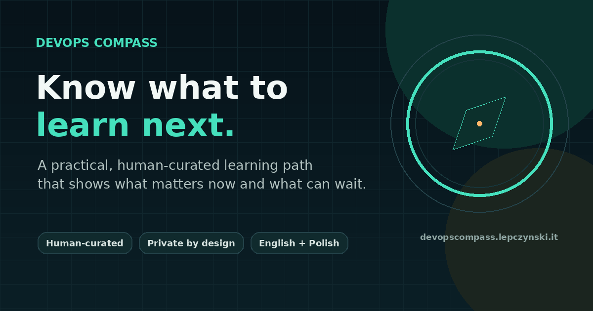

# DevOps Compass



A practical, human-curated DevOps learning path that shows what to learn now, what to verify and what can wait.

DevOps Compass is a static, bilingual browser application. It builds a focused path from a person's starting point, chosen direction and self-declared abilities. The complete competency graph remains underneath, while the interface exposes only the next useful part.

**Planned production address:** `https://devopscompass.lepczynski.it/`

## Why it exists

People entering DevOps often receive a giant list of tools without a useful order. DevOps Compass takes a different approach:

- concepts before product names,
- foundations before unnecessary complexity,
- concrete abilities instead of broad questions such as "Do you know Linux?",
- three current priorities instead of the entire roadmap,
- an honest self-assessment without fake readiness percentages.

The learning order, dependencies and practitioner notes are curated manually by [Wojciech Lepczyński](https://lepczynski.it/), based on more than ten years of work with DevOps, cloud platforms, CI/CD, automation, infrastructure and production systems.

## Features

- English and Polish interface
- Five-step, beginner-friendly onboarding
- A safe `DevOps Foundations` path for people who do not know their specialization yet
- Directions for DevOps, cloud, platform engineering, SRE and DevSecOps
- 81 learning units and 63 concrete capability statements
- Sections for `Learn now`, `Verify first`, `Up next`, `Later` and `Already covered`
- Progress stored in the browser with `localStorage`
- JSON export and import for backups and moving between devices
- No account, application backend, database or analytics
- Installable PWA with offline application shell
- Dark and light themes
- Responsive, dependency-free interface
- Open content model with automated validation

## Privacy model

The application does not create an account and does not send the learning profile to an application server. Answers, progress and settings stay in the current browser.

A browser profile is not a durable backup. Clearing site data, private browsing or changing devices may remove it. The application therefore provides explicit JSON export and import.

## Technology

- semantic HTML
- modern CSS
- vanilla JavaScript
- Cloudflare Workers Static Assets
- no runtime framework
- no external font, icon or analytics dependency

## Run locally

A basic static server is enough:

```bash
python3 -m http.server 8080 --directory public
```

Open `http://localhost:8080`.

For a Cloudflare-compatible local preview:

```bash
npx wrangler dev
```

## Validate the repository

```bash
npm run validate
```

Validation checks translations, unique IDs, competency dependencies, path references, required assets and JavaScript syntax.

## Deploy to Cloudflare

The repository contains `wrangler.jsonc` and is ready for Cloudflare Workers Static Assets.

### Direct deployment

```bash
npx wrangler login
npm run validate
npx wrangler deploy
```

### Git-based deployment

1. Push this directory to the `lepczynski-cloud/devops-compass` repository.
2. In Cloudflare, create a Worker by importing the GitHub repository.
3. Use `npm run validate` as the build command.
4. Use `npx wrangler deploy` as the deploy command.
5. Keep the Worker name `devops-compass`.
6. Add `devopscompass.lepczynski.it` as a Custom Domain.

Detailed instructions are available in:

- [Cloudflare deployment guide](docs/CLOUDFLARE_DEPLOYMENT.md)
- [Instrukcja wdrożenia po polsku](docs/CLOUDFLARE_PL.md)

## Repository structure

```text
public/
  assets/
    app.js              Application logic and UI
    data.js             Bilingual competency map and paths
    styles.css          Complete visual design
  index.html            Application shell
  manifest.webmanifest  PWA manifest
  sw.js                 Offline application shell
  _headers              Security and cache headers
tools/
  validate.mjs          Repository validation
docs/
  CONTENT_MODEL.md      Guide for maintaining the learning map
```

## Maintaining the content

The application deliberately separates content from UI logic. Competency names, Polish translations, prerequisites, evidence statements and direction paths live in `public/assets/data.js`.

Read [CONTENT_MODEL.md](docs/CONTENT_MODEL.md) before changing the map.

## Related projects

- [Wojciech Lepczyński's DevOps and cloud blog](https://lepczynski.it/)
- [YouTube channel](https://www.youtube.com/@WojciechLepczynski)
- [Admin Toolkit](https://admintoolkit.lepczynski.it/)

## Contributing

Corrections and evidence-based suggestions are welcome. Please read [CONTRIBUTING.md](CONTRIBUTING.md). The map is intentionally opinionated, but it should never be closed to review.

## License

Code and application content are available under the [MIT License](LICENSE).
